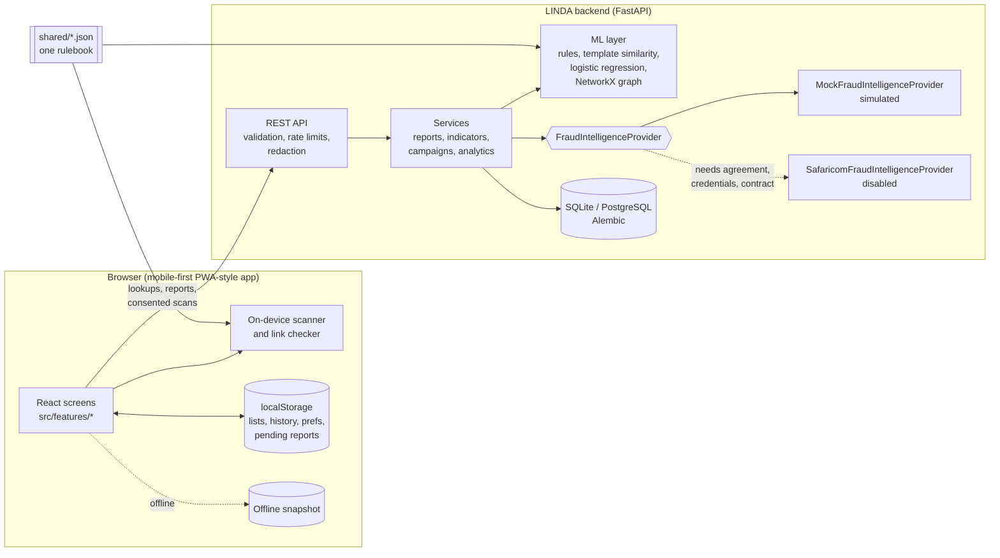

# Architecture

## Overview

## Key decisions

**One rulebook, two engines.** Message and link heuristics live in
`shared/*.json`. The browser runs them in TypeScript so messages never
leave the device; the backend runs the same JSON in Python for reports,
linking and model features. `shared/scanner_parity.json` holds Python
results for 116 messages and 14 links; the frontend test suite asserts
identical scores, bands, categories and flags, so the engines cannot
drift silently.

**Explainable detection, in layers.**

1. Rules (`scam_rules.json`): weighted patterns with negation handling
   ("do not share this code" is not a request), combination bonuses and
   plain-language advice. Score 0–100, four bands. Primary signal.
2. Template similarity (`app/ml/templates.py`): messages are reduced to
   templates (amounts, numbers, links removed) and compared with TF-IDF
   character n-gram cosine.
3. Model (`app/ml/model.py`): logistic regression over word n-grams plus
   rule hits, trained on a deterministic synthetic corpus of 24 template
   families. Evaluated on whole families it never saw. Exposed only as a
   consented "second opinion".
4. Graph (`app/ml/graph.py`): NetworkX connected components over phone,
   domain and template nodes, excluding weak brand edges.

**Explainable campaign linking** (`app/ml/linker.py`). Evidence types:
shared URL (0.85), similar template (similarity, up to 0.9), repeated
report pattern (0.4), shared external indicator (0.6, simulated) and
same brand (0.2, weak). Combined with noisy-OR. A link is created only at
≥ 60% confidence **and** with at least one strong, content-based signal.
Number-prefix similarity, network, device and timing are deliberately
ignored, so sharing a weak signal never makes two numbers "the same
person".

**Provenance is first-class.** Every campaign membership and edge carries
one of: `confirmed_simulated`, `community_report`, `model_inferred`,
`observed`. The UI shows each with a different line style (solid, dashed,
dotted, thin) and a text label, never colour alone.

**Provider abstraction** (`app/providers`). `FraudIntelligenceProvider`
defines `submit_report`, `poll_status`, `lookup_indicator`, `health` and
`describe`. The mock simulates receipt, review and corroboration and can
simulate an outage. The Safaricom adapter refuses every call until an
agreement, credentials **and** an implemented contract exist. See
[INTEGRATIONS.md](INTEGRATIONS.md).

**Report status model.** `draft` → `submitted_locally` →
`received_by_demo_service` → `under_review_simulated` →
`corroborated_simulated` | `inconclusive` | `rejected`.
`confirmed_by_authorised_source` exists in the model but only an
authorised provider could emit it; the mock never does (tested).

**Offline resilience.** Read-only screens fall back to a bundled
snapshot of the demo data and say so. Reports made while the backend is
unreachable are kept on the device as "Submitted locally" and sent
automatically later.

## Data model

| Table | Holds |
|---|---|
| `campaigns` | Synthetic campaigns with risk and confidence |
| `indicators` | Phones, domains, templates, brands; official contacts flagged |
| `campaign_links` | Indicator ↔ campaign membership with provenance, confidence, evidence |
| `indicator_edges` | Indicator ↔ indicator relations (shared URL, similar template …) |
| `messages` | Synthetic seed messages (ground truth used only for clustering evaluation) |
| `reports` | User and seed reports: hashed device ID, redacted text, status, link explanation |
| `report_events` | Status history with source and a simulated flag |

## Security and privacy

- **Data minimisation.** No accounts. A random device ID is stored on
  the device; the server keeps only a salted SHA-256 hash. IP addresses
  are hashed for rate limiting only.
- **Redaction.** PINs, OTPs, ID and card numbers are replaced with
  `[REDACTED]` in the browser before saving history and in the backend
  before storing notes or messages.
- **Consent.** Message text reaches the backend only when the user taps
  a consent prompt (campaign check, model second opinion) or chooses to
  include it in a report.
- **Validation.** Pydantic models with length limits; Kenyan phone
  normalisation; URL parsing that rejects non-web schemes; structured
  `{"error": {code, message, details}}` responses; generic 500s that
  never echo input.
- **Abuse prevention.** Per-device (DB) and per-IP (in-memory) rate
  limits, honeypot field, per-device duplicate detection (same indicator
  or same message within 24 h), "reported scam" requires three distinct
  reporters, and official contacts are never auto-linked to campaigns.
- **IDOR.** Report references are random; a report is returned only to
  the device hash that created it, and otherwise is indistinguishable
  from "not found".
- **XSS.** React escapes all text; highlighted messages are built from
  string segments, never `innerHTML`. Links are never rendered as
  clickable anchors in scan results.
- **Logs.** Method, path and status only. No query strings, bodies or
  identifiers. Lookups use POST bodies so numbers never appear in URLs.
- **Headers.** `nosniff`, `no-referrer`, `DENY` framing, `no-store`; CORS
  restricted to configured origins.
- **Retention.** User reports older than 90 days are purged at startup;
  users can export or delete their data at any time.
- **Kenya Data Protection Act, 2019.** The demo processes no real
  personal data. A live deployment would need a lawful basis and consent
  records, a DPIA, registration with the ODPC where required, and a
  data-sharing agreement with any fraud-intelligence partner.
